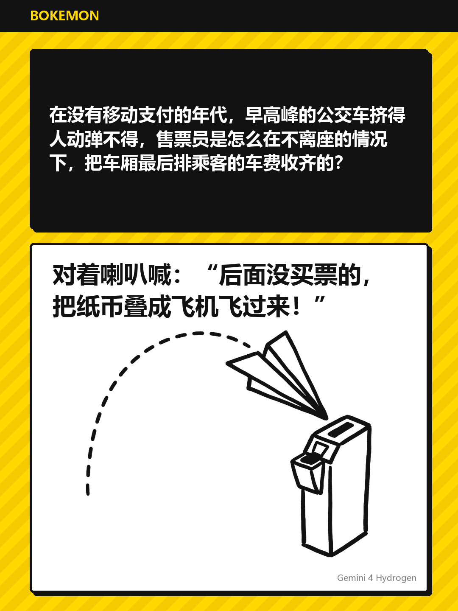
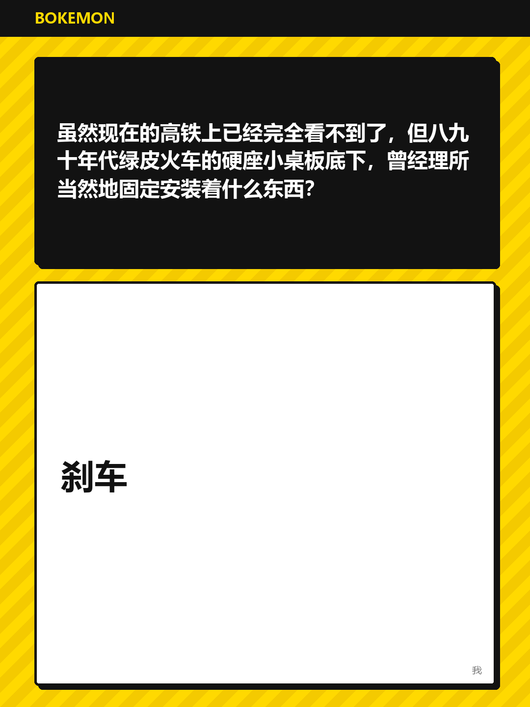

# oogiri

> 日式大喜利（Oogiri）Agent Skill —— 对齐 [Bokemon](https://github.com/Joffoo/Bokemon) 流水线，支持按需纯黑线条简笔画与 `BOKEMON` 分享卡一键导出。

[简体中文](#-简体中文) • [English](#-english) • [日本語](#-日本語)

<p align="center">
  
  &nbsp;&nbsp;
  
</p>

---

## 🇨🇳 简体中文

### 核心能力

- **对齐 Bokemon 流水线**：`Stage 0`（定锚常识核心与平庸三阱）→ `Stage 1`（单实例三轨一次发散：体面破绽 / 异业动作 / 物理死磕，单格一击、严禁讲故事）→ `Stage 2/3`（匿名盲评、8 条硬伤证伪、四维打分与单镜头终审提炼）。
- **按需纯黑简笔画配图**：文字回答照常独立定稿，不受配图干扰；仅当答案包含具体器物、荒诞装置或物理轨迹时，才按需生成**纯白底 + 纯黑粗线条（无颜色、无阴影、无字）**的简笔画，语言梗与冷笑话保持纯文字留白。
- **一键导出 BOKEMON 分享卡**：内置纯 Python/Pillow 渲染脚本 `scripts/render_ippon_card.py`，无需现场生成 HTML，省 token 且支持 `3:4` / `16:9` / `1:1`、`--split`（防剧透双图）、`--model`（右下角模型署名）与 `--batch` 批量导出。
- **看图大喜利压字**：内置 `scripts/render_meme.py`，为图片命题直接压制日式综艺粗黑描边纯白字幕。

### 安装

将本仓库克隆或复制到你的 Agent 技能目录（如 `.agents/skills/oogiri/` 或 `~/.config/agents/skills/oogiri/`）：

```bash
git clone https://github.com/Joffoo/oogiri.git .agents/skills/oogiri
```

前置依赖：Python 3 + `Pillow`（`pip install pillow`）。

### 卡片脚本用法

```bash
# 纯文字卡片（支持 --ratio 3:4 | 16:9 | 1:1，--split 生成防剧透双图 _q/_a）
python scripts/render_ippon_card.py \
  --q '虽然现在的高铁上已经完全看不到了，但八九十年代绿皮火车的硬座小桌板底下，曾经理所当然地固定安装着什么东西？' \
  --a '刹车' \
  --model '我' \
  -o 'output/card.png'

# 附加纯黑线条简笔画（支持 .png/.jpg/.svg 文件或 inline SVG 字符串）
python scripts/render_ippon_card.py \
  --q '在没有移动支付的年代，早高峰的公交车挤得人动弹不得，售票员是怎么在不离座的情况下，把车厢最后排乘客的车费收齐的？' \
  --a '对着喇叭喊：“后面没买票的，把纸币叠成飞机飞过来！”' \
  --model 'Gemini 4 Hydrogen' \
  --sketch 'sketch_q10.jpg' \
  -o 'output/card_sketch.png'

# 批量导出（JSON 数组：[{"q", "a", "model?", "sketch?", "filename?"}]）
python scripts/render_ippon_card.py --batch cards.json --out-dir output/cards
```

---

## 🇺🇸 English

### Overview

**oogiri** is an Agent Skill for Japanese-style **Oogiri (大喜利)** comedy generation and card rendering, aligned with the [Bokemon](https://github.com/Joffoo/Bokemon) single-instance divergence pipeline.

- **Grounded Comedy Pipeline**: `Stage 0` (extract physical/everyday premises and block hackneyed traps) → `Stage 1` (single-call 3-track divergence: decorum slips, cross-industry actions, physical extremes; one-shot punchlines, no storytelling) → `Stage 2/3` (blind judging with 8 falsification gates, 4-axis scoring, and single-shot recasting).
- **On-Demand Monochrome Sketches**: Text punchlines are finalized independently first so visuals never dilute the writing. Only answers with concrete objects, absurd contraptions, or physical trajectories receive a crude **black-ink-only doodle on pure white** (no colors, shading, or text).
- **Zero-HTML Card Renderer**: `scripts/render_ippon_card.py` renders `BOKEMON` IPPON-style share cards locally via Python/Pillow—supporting `3:4`, `16:9`, `1:1`, `--split` (spoiler-free Q/A pairs), `--model` attribution, and `--batch` JSON export.
- **Image Oogiri Subtitles**: `scripts/render_meme.py` burns Japanese variety-show white-with-black-stroke subtitles onto image prompts.

### Installation

Clone into your agent's skills directory:

```bash
git clone https://github.com/Joffoo/oogiri.git .agents/skills/oogiri
```

Requires Python 3 and `Pillow` (`pip install pillow`).

### Card CLI

```bash
python scripts/render_ippon_card.py \
  --q "<question>" \
  --a "<punchline>" \
  --model "<model_name>" \
  --sketch "<path_to_bw_sketch_or_svg>" \
  --ratio 3:4 \
  -o output/card.png
```

---

## 🇯🇵 日本語

### 概要

**oogiri** は、Web アプリ版 [Bokemon](https://github.com/Joffoo/Bokemon) のパイプラインに準拠した日本式「大喜利（オオギリ）」用の Agent Skill です。モノクロ線画スケッチの自動添え描きと、`BOKEMON` シェアカードのローカル一括書き出しに対応しています。

- **検証済みパイプライン**：`Stage 0`（お題の常識的土台と陳腐な罠の抽出）→ `Stage 1`（単一インスタンスでの 3 系統一括発散：体面のほころび／異業種ムーブ／物理的極限、1 コマ一撃・ストーリー展開禁止）→ `Stage 2/3`（匿名ブラインド審査・8 つの致命傷判定・4 軸採点・単一カットへの磨き上げ）。
- **オンデマンドのモノクロ線画**：まずテキストのボケを独立して完成させ、文章のキレを損なわないようにした上で、具体的な物体・装置・軌道が笑いを増幅させる場合のみ**白地に黒インク線のみ（着色・陰影・文字なし）**のラフ画を添えます。
- **HTML 不要のローカルカード生成**：`scripts/render_ippon_card.py`（Python / Pillow）により、`3:4`・`16:9`・`1:1`、`--split`（ネタバレ防止の 2 枚組）、`--model`（右下モデル名表記）、`--batch`（JSON 一括出力）を即座に生成できます。
- **写真で一言テロップ**：`scripts/render_meme.py` でバラエティ番組風の黒縁取り白テロップを画像に焼き込めます。

### インストール

お使いのエージェントのスキルディレクトリへクローンしてください（要 Python 3 + `Pillow`）：

```bash
git clone https://github.com/Joffoo/oogiri.git .agents/skills/oogiri
```
